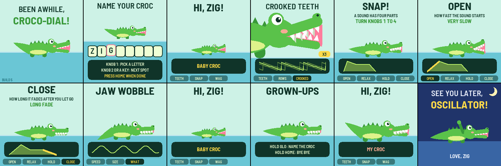

# Croc-O-Synth

A kid-friendly firmware idea for the M-VAVE FM-1 pocket synth: a crocodile teaches synth basics, one lesson per button.

This repository holds two things:

- **`prototype/index.html`**: a click-through mock of the FM-1 panel in a browser, with a stand-in sound engine. This is where the lessons are designed.
- **`app/`**: the real firmware, in C, built on [fm1-base](https://github.com/charlesvestal/fm1-base). So far: the greeting, the home croc, the Teeth, envelope, tail wag, swamp echo and lily pad lessons, the jaws, three croc sizes, the presets with My Croc, the croc's name, and the goodbye. It runs in fm1-base's simulator and on a real FM-1.

## Try the prototype

Open `prototype/index.html` in a browser. Tap the screen to wake the croc.

- Drag a knob, or tap its right or left side.
- Hold HOME to say bye bye. Hold GLO to name the croc.
- On a computer, the keys A to ; play notes.

## Lessons

| Control | Lesson | Synth idea |
| --- | --- | --- |
| EDIT | Teeth | Wave shape; rows of teeth are unison voices (x1 to x3); crooked is detune |
| ENV | Snap or yawn | Open, Relax, Hold, Close: attack, decay, sustain, release |
| LFO | Tail wag: speed, size, tickle | LFO rate, depth, destination. Tickle the tail is pitch, the belly is volume, the snoot is the filter |
| FX | Swamp echo and cave | Delay amount and time, reverb |
| SEQ + PLAY | Lily pad steps | Eight-step sequencer |
| SCL | Safe swamp | Scales: major, minor, harmonic minor, melodic minor, harmonic major, Dorian, Phrygian, Lydian, Mixolydian, Locrian, on any home note. The keys in the scale stay lit on every page |
| OCT- / OCT+ | Small croc, croc, big croc | Octave: three of them, all inside the speaker's range |
| PRESETS knob | Surprise | Five sounds plus her own, kept as My Croc |
| ALGORITHM knob | Jaws | Filter cutoff |
| SELECT knob | Hop speed | Tempo |
| MASTER knob | Volume | Capped |

Screens: "Been awhile, croco-dial!" on start-up, "See you later, oscillator!" on goodbye, and a name-your-croc screen on first power-on.

## Build the firmware

    git clone --recursive https://github.com/Goosegoosegoosegoosegoose/croc-o-synth
    ./build.sh --host          # the simulator (needs a C compiler, Python 3 with Pillow and fontTools)
    tests/run_tests.sh         # builds the simulator and runs the checks: screens, saved settings, sound
    ./build.sh                 # the package for a real FM-1 (needs the JieLi toolchain and SDK; see base/README.md)

The package is also built on GitHub: the **Build firmware** workflow (Actions tab) runs the tests, builds for the FM-1 and keeps `crocosynth.fwsc` as a download. To put it on an FM-1, see [docs/FLASHING.md](docs/FLASHING.md).

The simulator runs a script of presses and turns and writes screenshots and audio: see `app/tests/`.

| File | What |
| --- | --- |
| `app/app.c` | The screens and the controls |
| `app/synth.c` | The sound: up to four notes, one to three oscillators each, envelope, filter |
| `app/draw.c` | Shapes, text and the placeholder croc |
| `app/platglue.c`, `app/app.h`, `app/fm1.toml`, `app/words.tsv` | Adapted from fm1-base's template (MPL-2.0) |
| `base/` | fm1-base, a git submodule (MPL-2.0) |

Each firmware build and what changed in it is listed in [CHANGELOG.md](CHANGELOG.md). To work on the firmware, start with [DEVELOPING.md](DEVELOPING.md).

## Not built yet

- ARP (croc hops), REC (croc remembers), SAVE
- Challenges and stars for each lesson
- Final croc and background art (the current drawing is a placeholder)

## What the firmware is built on

The firmware is built on open projects, and none of Felucca's own GPL code is copied:

- Platform, simulator and build tools: https://github.com/charlesvestal/fm1-base (MPL-2.0)
- Hardware layer, inside fm1-base: https://github.com/hugelton/felucca-bsp (MPL-2.0)
- Felucca, read for hardware facts only: https://github.com/hugelton/Felucca (GPL-3.0-only)

The FM-1 has a 240 x 240 colour screen, 7 encoders plus a volume pot, 14 buttons and 27 keys (F3 to G5). Art should be drawn for 240 x 240, with the croc in separate parts (body, upper jaw, lower jaw, tail, teeth, eyes, waving arm) so it can move.

## Licence

Copyright 2026 goose

- **Code** (the prototype, and `app/app.c`, `app/synth.c`, `app/draw.c`): [PolyForm Noncommercial License 1.0.0](LICENSE.md). Free to use, change and share for non-commercial purposes. Selling it or using it commercially needs permission.
- **Art, screens, names and text**: [CC BY-NC-SA 4.0](LICENSE-ART.md).
- **Borrowed parts keep their own licences.** `base/` (fm1-base and felucca-bsp) and the files adapted from fm1-base's template (`app/platglue.c`, `app/app.h`, `app/fm1.toml`, `app/words.tsv`) are MPL-2.0; the notices above do not apply to them.

Required Notice: Copyright 2026 goose (https://github.com/Goosegoosegoosegoosegoose)

See [PROVENANCE.md](PROVENANCE.md) for what this project took, copied and renamed from other firmware. So far no code has been copied.

Unofficial. Not affiliated with M-VAVE.
